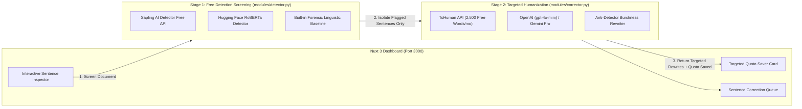

# VeriText AI — Two-Stage AI Origin Checker & Targeted Sentence Humanizer (PoC)

An executive Proof-of-Concept (PoC) built with **Nuxt 3 (Frontend)** and **Python FastAPI (Backend)** demonstrating a cost-efficient **Two-Stage Architecture** that separates **Initial AI Screening (Free Detection)** from **Targeted Sentence Humanization (Quota-Smart Rewriting)**.

---

## 🎯 Executive Strategy & CEO Talking Points

1. **Detection $\neq$ Humanization**:
   - **Stage 1 (Detection Engine)** identifies *which specific sentences* trigger AI alerts using free/baseline detectors (**Sapling Free Tier**, **Hugging Face Open-Source RoBERTa**, or **Forensic Linguistic Baseline**).
   - **Stage 2 (Targeted Humanization Engine)** applies rewrite quotas (**ToHuman API's 2,500 free words/month** or **OpenAI / Gemini**) **only** to the sentences flagged as AI—skipping sentences that already sound human and saving 50–80% of monthly rewrite quota.
2. **Pitch to the CEO**:
   > *"We built a two-stage workflow: first we run free detection screening to isolate problem sentences, and then we apply targeted humanization only to the flagged sentences using free monthly quotas (like ToHuman's 2,500 words/mo). This proves the concept at zero cost before we consider scaling to paid production APIs (such as Rephrasy or TextSight Pro)."*

---

## System Architecture (Two-Stage Pipeline)



---

## Project Structure

```text
ai-checker/
├── docker-compose.yml           # One-command startup for both Frontend & Backend
├── .env.example                 # Template for Sapling, HuggingFace, ToHuman, OpenAI, & Gemini keys
├── start.sh                     # Helper script to run locally without Docker
├── README.md                    # Documentation & CEO setup guide
├── backend/                     # Python FastAPI Service (Port 8000)
│   ├── Dockerfile
│   ├── requirements.txt
│   ├── main.py                  # FastAPI endpoints (/api/analyze, /api/correct-sentence, /api/test-key)
│   └── modules/
│       ├── detector.py          # Stage 1: Sentence-level AI screening & quota-saving calculator
│       ├── corrector.py         # Stage 2: Targeted sentence humanizer (ToHuman + LLM + Anti-Detector)
│       ├── llm_client.py        # Unified client for OpenAI, Gemini, Anthropic + key diagnostics
│       └── samples.py           # Pre-loaded executive demo scenarios
└── frontend/                    # Nuxt 3 + Tailwind CSS Dashboard (Port 3000)
    ├── Dockerfile
    ├── package.json
    ├── nuxt.config.ts
    └── app.vue                  # Interactive Sentence Inspector, Quota Efficiency Card & Error Diagnostics
```

---

## Local Setup Guide (For CEO / Reviewer)

### Option A: Run with Docker Compose (Recommended)

1. **Clone the repository**
   ```bash
   git clone <YOUR_GITHUB_REPO_URL>
   cd ai-checker
   ```

2. **Configure `.env`**
   ```bash
   cp .env.example .env
   ```
   Open `.env` and add your keys (all optional—works out of the box with the built-in engine, or with any combination of free/paid keys):
   - **Stage 1 Detection (Optional Free Keys)**: `SAPLING_API_KEY` or `HUGGINGFACE_API_KEY`
   - **Stage 2 Humanization**: `TOHUMAN_API_KEY` (2,500 free words/mo), `OPENAI_API_KEY`, or `GEMINI_API_KEY`

3. **Start the containers**
   ```bash
   docker compose up -d --build
   ```

4. **Open in your browser**
   - **Frontend Dashboard**: [http://localhost:3000](http://localhost:3000)
   - **Backend Swagger API Docs**: [http://localhost:8000/docs](http://localhost:8000/docs)

---

### Option B: Run Locally Without Docker

```bash
chmod +x start.sh
./start.sh
```

---

## Backend API Endpoints

| Method | Endpoint | Description |
| :--- | :--- | :--- |
| `GET` | `/api/health` | Health check and active provider status |
| `POST` | `/api/test-key` | Live diagnostic test for OpenAI / Gemini / Anthropic API keys |
| `GET` | `/api/samples` | Returns pre-loaded executive demo text presets |
| `POST` | `/api/analyze` | Runs Stage 1 AI Detection Screening + Stage 2 Targeted Rewrite Suggestions + Quota Metrics |
| `POST` | `/api/correct-sentence` | Generates fresh human rewrites for a single targeted AI sentence |
