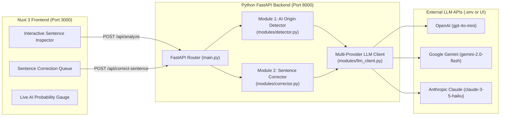

# VeriText AI — AI Origin Checker & Interactive Sentence Humanizer (PoC)

An executive Proof-of-Concept (PoC) built with **Nuxt 3 (Frontend)** and **Python FastAPI (Backend)** designed to detect AI-generated text at the sentence level and interactively rewrite ("humanize") flagged sentences so documents read with authentic human voice and clarity.

---

## Why This Matters (Executive Summary)

1. **Detect Unedited AI Copy Before It Ships**: Identifies robotic phrasing, synthetic LLM transitions (*"Furthermore"*, *"Moreover"*, *"delve"*, *"tapestry"*, *"testament"*), and uniform sentence cadence across emails, reports, and marketing copy.
2. **Actionable Sentence-by-Sentence Correction**: Rather than just giving a pass/fail score, the system highlights exact AI-sounding sentences and generates **3 tailored human rewrites** (*Natural & Direct*, *Executive Crisp*, *Conversational*) that users can accept or customize in one click.
3. **Measurable Quality Improvement**: Tracks the **Before vs. After AI Probability Score** in real time as flagged sentences are corrected.

---

## System Architecture



---

## Project Structure

```text
ai-checker/
├── docker-compose.yml           # One-command startup for both Frontend & Backend
├── .env.example                 # Template for OpenAI / Gemini / Anthropic API keys
├── start.sh                     # Helper script to run locally without Docker
├── README.md                    # Documentation & CEO setup guide
├── backend/                     # Python FastAPI Service (Port 8000)
│   ├── Dockerfile
│   ├── requirements.txt
│   ├── main.py                  # FastAPI endpoints (/api/analyze, /api/correct-sentence)
│   └── modules/
│       ├── detector.py          # Module 1: Sentence-level AI detection & linguistic metrics
│       ├── corrector.py         # Module 2: Interactive sentence humanizer & rewrite engine
│       ├── llm_client.py        # Unified client for OpenAI, Gemini, Anthropic + fallback
│       └── samples.py           # Pre-loaded executive demo scenarios
└── frontend/                    # Nuxt 3 + Tailwind CSS Dashboard (Port 3000)
    ├── Dockerfile
    ├── package.json
    ├── nuxt.config.ts
    └── app.vue                  # Interactive Sentence Inspector & Correction Queue UI
```

---

## Core Modules Breakdown

### Module 1: Forensic AI Detection (`backend/modules/detector.py`)
- **Sentence Segmentation**: Splits documents into individual sentences and evaluates each sentence's AI probability (`0–100%`).
- **Quantitative Linguistic Signals**:
  - **Burstiness Score (`0–100`)**: Measures variation in sentence length and structure (humans write with high burstiness; AI writes with uniform sentence lengths).
  - **Uniformity Index (`%`)**: Detects mechanical symmetry across clauses.
  - **Vocabulary Richness (`0–100`)**: Evaluates Type-Token Ratio (lexical diversity).
  - **AI Cliché Density**: Flags signature LLM phrases (*"delve"*, *"tapestry"*, *"testament"*, *"strategic imperative"*, *"furthermore"*, etc.).
- **Diagnostic Explanations**: Attaches clear reasons explaining *why* each flagged sentence appears AI-generated.

### Module 2: Interactive Sentence Corrector (`backend/modules/corrector.py`)
- **Multi-Tone Human Rewrites**: For every sentence flagged as `AI` ($\ge 65\%$) or `Mixed` ($40\text{--}64\%$), generates 3 distinct human alternatives:
  1. **Natural & Direct** — Clear, grounded everyday business prose.
  2. **Executive Crisp** — Concise, high-impact leadership communication.
  3. **Conversational** — Warm, authentic human cadence.
- **Interactive Controls**:
  - **Accept Fix**: Replaces the flagged sentence in-place and immediately recalculates the document's overall AI score.
  - **Edit Manually**: Inline editor to tweak any sentence directly.
  - **Regenerate Options**: Calls `POST /api/correct-sentence` to generate fresh human rewrites on demand.
  - **Revert to Original**: Restores the original sentence at any time.

---

## Local Setup Guide (For CEO / Reviewer)

### Option A: Run with Docker Compose (Recommended)

**Prerequisites**: [Docker Desktop](https://www.docker.com/products/docker-desktop/) installed and running.

1. **Clone the repository**
   ```bash
   git clone <YOUR_GITHUB_REPO_URL>
   cd ai-checker
   ```

2. **Configure environment file**
   ```bash
   cp .env.example .env
   ```
   Open `.env` and add your API key for **one** of the supported providers (`OPENAI_API_KEY`, `GEMINI_API_KEY`, or `ANTHROPIC_API_KEY`).
   > **Tip**: You can also leave `.env` blank and paste your API key directly inside the web dashboard by clicking **⚙️ LLM API Config** in the top-right corner. Even without an API key, the built-in linguistic engine works out of the box.

3. **Start the system**
   ```bash
   docker compose up --build
   ```

4. **Open in your browser**
   - **Frontend Dashboard**: [http://localhost:3000](http://localhost:3000)
   - **Backend Swagger API Docs**: [http://localhost:8000/docs](http://localhost:8000/docs)

---

### Option B: Run Locally Without Docker

**Prerequisites**: Python 3.9+ and Node.js 18+ installed.

```bash
chmod +x start.sh
./start.sh
```
This script automatically creates a Python virtual environment in `backend/.venv`, installs dependencies, starts FastAPI on port `8000`, installs Nuxt packages, and starts the Nuxt 3 frontend on port `3000`.

---

## 2-Minute CEO Demo Walkthrough

1. Open [http://localhost:3000](http://localhost:3000).
2. At the top bar (**One-Click CEO Demo Scenarios**), click:
   - **`100% AI — Corporate Strategy Memo`**: Watch the detector flag the document as **High AI** and highlight each robotic sentence in red.
   - Click any highlighted sentence in the left **Interactive Sentence Inspector** (or in the right **Sentence Correction Queue**) to see *why* it was flagged and view **3 human rewrite options**.
   - Click **Accept Fix** on a suggestion (or click **✨ Accept All Fixes** in the queue header) and watch the **Current AI Probability** drop from **~85%+ down to <10% Human** in real time.
3. Click **`Mixed — Product Launch Post-Mortem`** to see how the system distinguishes authentic human sentences from AI-polished paragraphs within the same document.
4. Click **`100% Human — Founder Slack Update`** to verify low false-positive rates on natural human writing.

---

## Backend API Endpoints

| Method | Endpoint | Description |
| :--- | :--- | :--- |
| `GET` | `/api/health` | Health check and active LLM provider status |
| `GET` | `/api/samples` | Returns pre-loaded executive demo text presets |
| `POST` | `/api/analyze` | Analyzes text for AI origin, linguistic metrics, and sentence-level suggestions |
| `POST` | `/api/correct-sentence` | Generates fresh human rewrites for a specific flagged sentence |
